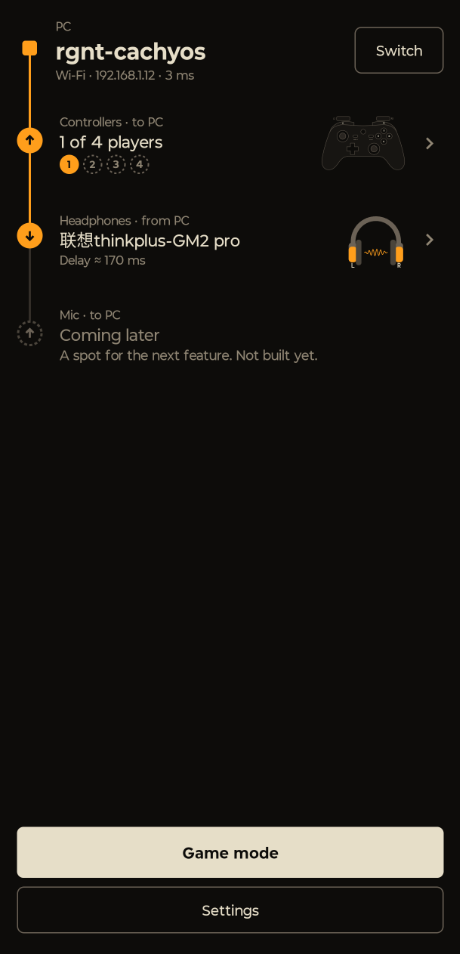
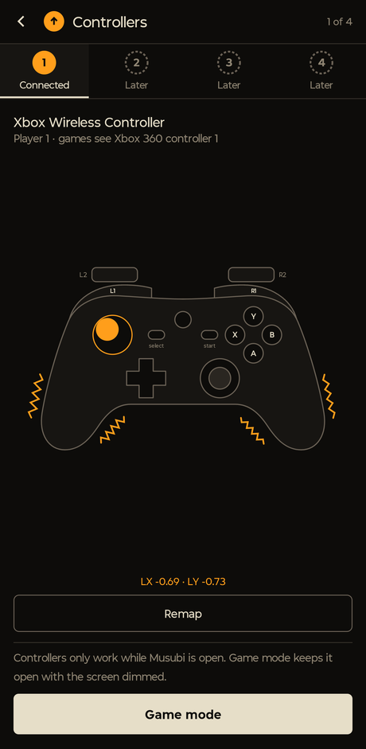
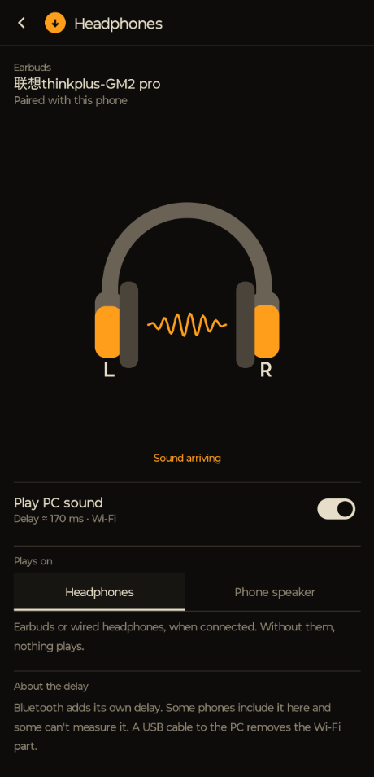
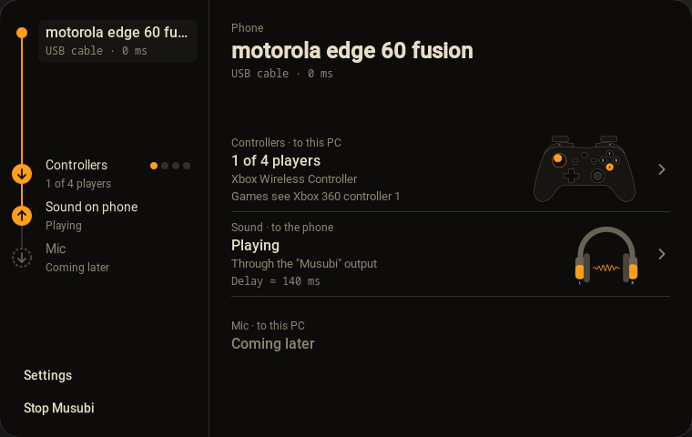

<p align="center">
  
</p>

<h1 align="center">Musubi</h1>

<p align="center">
  <strong>Use your phone as the Bluetooth hub your PC doesn't have.</strong>
</p>

Pair a Bluetooth gamepad with an Android phone, and your Linux PC gets a virtual Xbox 360 pad that games treat as a normal controller. Since 0.6.0 it also works the other way: your PC's sound can play on the earbuds paired with the phone. I built it because my PC has no Bluetooth and I had an old phone lying around.

<p align="center">
  
  &nbsp;
  
  &nbsp;
  
</p>

**Early stage.** It has run on two Arch-based PCs and four Android phones, including an LG K40S, a Samsung A12 and a Motorola Edge 60 Fusion. I've played Persona 5 Royal with it on one PC using a BSP G6 pad. On the second PC I only checked the controller on a gamepad tester page. Please open an issue if something fails on your setup.

## Why "Musubi"?

*Musubi* (結び) means "tying" or "connecting" in Japanese. In [Your Name](https://anilist.co/anime/21519/Kimi-no-Na-wa/), Mitsuha's grandmother explains it while braiding cords: musubi is the thread that ties people together, even across distance and time, and that thread can twist, tangle, come apart and connect again.

That's what this app does. Your Bluetooth devices and your PC can't reach each other on their own, so your phone becomes the knot in the middle that ties them together. The cord runs both ways: your controller's input travels up to the PC, and the PC's sound travels back to your earbuds.

## What you need

- A Linux PC with Python 3, `python-evdev` and access to `/dev/uinput`. Windows and macOS won't work, because the virtual pad depends on `uinput`. The desktop app also needs GTK 4 and PyGObject. Sound on the phone needs `pactl` and `parec`, which come with PipeWire's PulseAudio support on most desktops.
- An Android phone with the app open while you play. The app declares Android 5.0 or newer, but it has only run on those four phones.
- A Bluetooth gamepad that Android recognizes as a gamepad.
- The phone and the PC on the same network, or a USB cable between them.

## Setup

### 1. Prepare the PC

On Arch-based systems:

```sh
sudo pacman -S --needed git python python-evdev python-pyusb gtk4 python-gobject python-cairo
```

Use the equivalent packages on other distributions. Then get the code and check that you can use `uinput`:

```sh
git clone https://github.com/Multex/musubi.git
cd musubi
test -r /dev/uinput && test -w /dev/uinput && echo 'uinput access OK' || echo 'Check uinput access'
```

If that prints `Check uinput access`, see [uinput permissions](#uinput-permissions).

### 2. Start the desktop app

This adds Musubi to your app launcher, so you only need the terminal once:

```sh
./install.sh
```

Open **Musubi** from your launcher. It shows the address to type on your phone. If your `ufw` firewall blocks the phone, the app offers to open UDP port 9999 for your local network. If you use another firewall, allow that port yourself.

### 3. Set up the phone

1. Download `musubi.apk` from [Releases](https://github.com/Multex/musubi/releases/latest) on the phone and install it. Android will ask you to allow installs from that source, and you can turn that off again afterwards.
2. Disconnect the pad from the PC if it is plugged in, because some pads stay in USB mode.
3. Put the pad in pairing mode and pair it in the phone's Bluetooth settings. The button combination depends on the pad, so check its manual.
4. Open Musubi, type your PC's IP in **PC IP address** and tap **Save PC**.
5. On the PC, click **Allow** when the desktop app asks about the phone. The phone's Home screen then shows the PC with its ping in milliseconds. You can save more than one PC and switch between them from the Home screen.
6. Tap **Controllers** and press a button. It lights up on both drawings, and the virtual pad reacts on the PC.

Keep the app open and in front while you play. **Game mode** dims the screen and stops drawing the controller, and it turns on by itself after 1 minute without touching the screen. You can turn that off in **Settings**.

Update the PC and the phone together. Over Wi-Fi the desktop app still works with older phone apps, but over the USB cable both sides must be on 0.6.0 or newer.

### Over a USB cable

The cable is still being tested, and so far it has worked on one phone. Wi-Fi stays the main way to connect.

Plug the phone into the PC while the desktop app is running, and set its USB mode to **File transfer** from the USB notification. Musubi then switches the phone into accessory mode, and Android asks whether to open Musubi when this accessory connects. Tick **Always** and tap **OK**. From then on, plugging in opens the app and the pad works over the cable, with no IP to type and no firewall to open. The phone charges while you play.

This needs `python-pyusb` and the USB rule that `./install.sh` adds. The cable only works with the desktop app, not with `musubi.py` in a terminal.

### Without the desktop app

You can still run the receiver in a terminal, with your phone's IP. You need to open the firewall yourself:

```sh
sudo ufw allow from 192.168.1.10 to any port 9999 proto udp
```

```sh
python3 desktop/musubi.py 192.168.1.10
```

## Desktop app

<p align="center">
  
</p>

- **Sidebar:** shows the connected phone, its link (Wi-Fi or USB cable) and ping, with pages for **Overview**, **Controllers** and **Sound on phone**.
- **Overview:** the phone, the controller and the sound at a glance. **Controllers** shows the live pad, and **Sound on phone** shows the PC's sound levels and can turn sound off from the PC.
- **Allowed phones:** a new phone asks for your approval once. Manage them in **Settings > Manage phones**. Phones are recognized by IP, so reserve the address in your router if you can, or the phone will ask again when it changes. If you ignore or remove a phone, the waiting screen offers **Allow** for as long as that phone keeps trying to connect.
- **Virtual controller:** it only exists while a controller is connected to the phone, so games don't see a pad you can't use.
- **Start with my PC:** this adds a systemd user service in **Settings**. It needs a desktop session that starts `graphical-session.target`. If yours doesn't, the app shows the command to add to your desktop's startup instead.
- **Tray:** if your desktop has a tray, closing the window keeps Musubi running there. Without one, closing the window quits.

## Remap

<p align="center">
  
</p>

On the **Controllers** page, tap **Remap** and press each button as the app asks, or tap **Skip** for the ones your pad doesn't have. You can try the layout before saving it. Each controller keeps its own layout, and **Reset** goes back to the default. Sticks can't be remapped.

## Vibration

When a game rumbles the controller, the phone makes your real pad vibrate, with the strong and weak motors kept apart. Waves on the controller drawing show it, on the phone and on the PC. It depends on the pad: Android has to be able to vibrate it over Bluetooth. If yours can't, the Controllers page says so.

## Headphones

Musubi can play your PC's sound on the earbuds paired with your phone. It's off by default.

1. On the phone, open **Headphones** from the Home screen and turn on **Play PC sound**.
2. On the PC, pick **Musubi** as the output in your sound settings. It only appears while a phone with sound turned on is connected.
3. Choose where it plays: **Headphones** (your earbuds, or wired headphones) or **Phone speaker**. With Headphones picked and no earbuds connected, nothing plays.

It works over Wi-Fi and the USB cable, and keeps playing when you switch between them. If you leave the app or lock the screen, the sound keeps going, with a notification that has a **Stop** button.

**Delay:** Musubi's own part is about 70 ms. Bluetooth earbuds add their own delay on top, often 100 to 250 ms. If your earbuds have a game or low-latency mode, turn it on: on mine it cut the total from about 330 ms to about 150 ms.

## Limits

- **The controller needs the app on screen.** Android only gives controller input to the app in front, so if you leave the app, the PC releases every button after half a second. **Game mode** keeps the screen on but dim. Sound is different: it keeps playing in the background.
- **One pad at a time.** Two pads paired with the phone would be merged into one. *(for now)* Bluetooth earbuds that pretend to be a controller for their media buttons are ignored so they don't take the controller spot.
- **The guide button can't be remapped,** and it may not arrive at all, because Android can keep it for itself.
- **One phone at a time.** If two allowed phones are on, the first one keeps the pad until it has been silent for 5 seconds.
- **Use it only on a network you trust.** Packets are not encrypted or authenticated, and approval only checks the IP. Someone on your network who fakes an allowed phone's address could press buttons in your game.

## Latency

Total latency, from pressing a button to the game reacting, has not been measured.

The only number so far is the network ping between the PC and the K40S with the app open: 9 ms median and 71 ms maximum over 300 pings, with none lost. That is a round trip with the PC on cable and the phone on 2.4 GHz Wi-Fi, and it leaves out Bluetooth and Android's own input handling.

Persona 5 plays fine, but it is turn-based. I can't vouch for rhythm or fighting games yet.

## Troubleshooting

| Problem | What to check |
| --- | --- |
| The game doesn't see the pad | Connect the controller to the phone first, then restart the game. |
| The game sees two pads | Your real pad is still connected to the PC. Disconnect it. |
| The desktop app says it **can't use** the USB cable | Install `python-pyusb`, or run `./install.sh` again so the USB rule is added, then plug the phone back in. |
| The phone says **PC not responding** | Check that Musubi is running on the PC and that you allowed the phone, then check the firewall and the phone's IP. Some routers also block Wi-Fi devices from reaching wired ones. |
| A button shows `(not mapped)` on the phone | Your pad sends a key Musubi doesn't know yet. Use **Remap** to assign it. |
| The desktop app says it **can't run** | Another program is using UDP port 9999. Check that `musubi.py` isn't still running in a terminal. |
| No **Musubi** output in the PC's sound settings | Turn on **Play PC sound** on the phone's Headphones page. The output only exists while the phone is connected with sound on. |
| Sound cuts out with the phone locked | Locked phones save power on Wi-Fi. Use 5 GHz Wi-Fi or the USB cable. |
| **Open the port** fails | Your desktop may have no password prompt for system changes. The app shows a command you can run in a terminal instead. |

### uinput permissions

If `/dev/uinput` doesn't exist, load the module:

```sh
sudo modprobe uinput
```

If it exists but you can't write to it, this rule gives access to the user logged in at the PC:

```sh
echo 'KERNEL=="uinput", SUBSYSTEM=="misc", TAG+="uaccess", OPTIONS+="static_node=uinput"' | sudo tee /etc/udev/rules.d/60-musubi-uinput.rules
```

```sh
sudo udevadm control --reload && sudo udevadm trigger --name-match=uinput
```

Any program you run can then create virtual input devices, so remove the rule if you stop using Musubi.

## How it works

Each controller packet is 20 bytes and holds the whole pad state: 11 button bits, then 8 axes (`!I8h` in `desktop/musubi.py`). The app sends one on every change and at least every 50 ms, so a lost packet is repaired by the next one and a release can't get stuck. After 0.5 seconds of silence, the receiver releases everything.

Once a second the app also sends an 8-byte ping, and the receiver echoes it back to allowed phones. That is how the app knows the PC is answering and what the round trip takes. It also sends a hello packet with the phone's model, the controller's name, that ping time, and a feature flag for sound.

When the phone announces that **Play PC sound** is on, the PC loads a virtual `Musubi` output (`module-null-sink` via `pactl` in `desktop/audio.py`) and captures 48 kHz 16-bit stereo PCM in 5 ms chunks with `parec`. Each chunk goes back over the same UDP socket (or USB cable) with a 2-byte sequence number (`!4sH`). After 200 ms of silence the PC stops sending chunks until sound plays again. On the phone, an adaptive jitter buffer (`android/AudioBuffer.java`) feeds a low-latency `AudioTrack`, and a foreground service (`android/KeepAliveService.java`) keeps the sound going in the background.

When a game sends force feedback to the virtual pad, the PC sends the strong and weak motor levels and the duration back to the phone (`!4sHHH`), and the phone drives the pad's motors (both motors on Android 12 and newer, one on older versions).

Over a USB cable the phone uses Android Open Accessory instead of Wi-Fi. The PC asks the phone to switch modes (`desktop/cable.py`), and then the same packets travel over USB, each one starting with its length in 2 bytes.

The desktop app runs the receiver as a separate process, so drawing the window can't delay the pad.

The virtual pad uses the same IDs and layout as the kernel's `xpad` driver, so games map it as an Xbox 360 pad.

## Build the app

`build.sh` calls the SDK tools directly, without Gradle. You need `platforms;android-28` and `build-tools;34.0.0` in `~/Android/Sdk`, or in `ANDROID_HOME`. It needs Java 17, because `d8` crashes on Java 27. The script looks in `/usr/lib/jvm/java-17-temurin`, so set `JAVA_HOME` if yours is somewhere else.

```sh
./build.sh
```

The result is `android/build/musubi.apk`. The first build creates `android/debug.keystore`, which stays out of git. Keep that file: Android refuses updates signed with a different key.

`build.sh` also runs the button map and audio buffer tests. Run the PC tests with:

```sh
python3 desktop/test_musubi.py
python3 desktop/test_cable.py
python3 desktop/test_system.py
```

## AI disclosure

AI tools (Claude and Gemini) are used to help write code, debug, and explore ideas in this project. Nothing here is "vibe-coded" or merged blindly: every change is directed, read line by line, and tested on real phones and PCs before it lands. None of the art is AI-generated.

If you open an issue or a pull request, please write the description yourself and make sure you understand and have tested every line of code you send. Unchecked AI output ("AI slop") will be closed. If you used AI to help write a patch, mention it in the pull request.

## Credits

The Musubi icon was designed by [@sr.miaomix](https://www.instagram.com/sr.miaomix/). Check out her work!

## License

[MIT](LICENSE)
